# video-edits

**Short vertical video, made from code.** Every reel below was cut, typed, animated and exported by an editing agent working through the tools in this repo: FFmpeg, Python, HyperFrames and small JSON specs. No timeline editor, no paid API, no stock library.

<p align="center">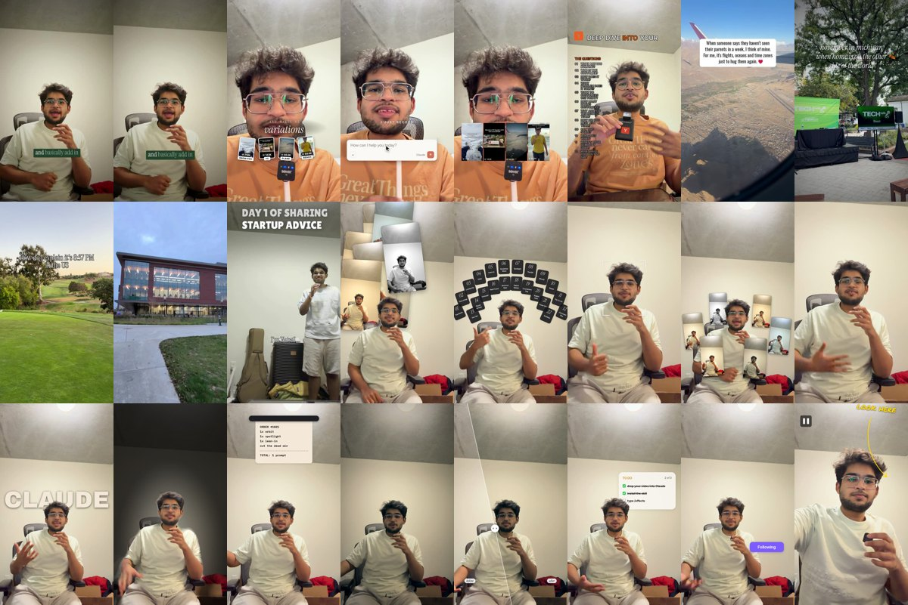</p>

**[▶ Watch the 14 finished reels](https://drive.google.com/drive/folders/1aBELUVyYtmqNolzyXqawnfVl85__DHg7)** · **[Tap through all 76 looks](https://vatsal2006350.github.io/video-edits/)** · **[Start a video](START-HERE.md)**

- 14 finished reels made by the agent, on Google Drive, with thumbnails below
- 76 looks with a preview clip each; 70 of them run straight from this repo
- A 70-effect overlay library (`bin/fx-extra.sh list`) plus 20 heavier one-shot effects (`bin/run-visual-effect.sh list`)
- A motion-design track: one shape, no cuts, rendered from HTML ([`formats/motion-design.md`](formats/motion-design.md))
- 43 format notes with the numbers each look was measured at

## Finished reels

Made by the editing agent from raw phone footage. Click a thumbnail to watch.

<!-- reels:start -->
<table>
<tr><td width="33%" valign="top"><a href="https://drive.google.com/file/d/1ek_oA7HxoES0EP0ha7rP1wVpvUBlJFj3/view">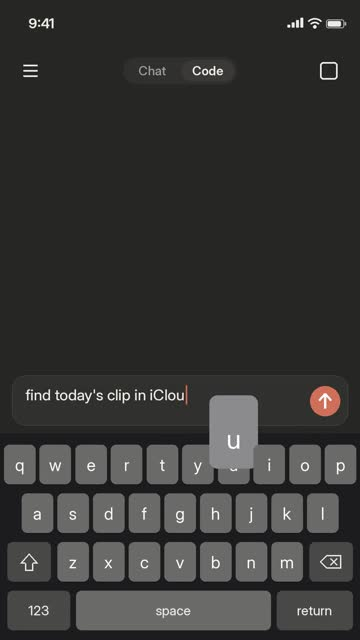</a><br><a href="https://drive.google.com/file/d/1ek_oA7HxoES0EP0ha7rP1wVpvUBlJFj3/view"><b>Claude effects montage</b></a><br><sub>70-effect library on one talking-head clip · 31s</sub></td><td width="33%" valign="top"><a href="https://drive.google.com/file/d/1Xhcc1PhLWrPN7zdfXWiWqe9c-VAGdc1v/view">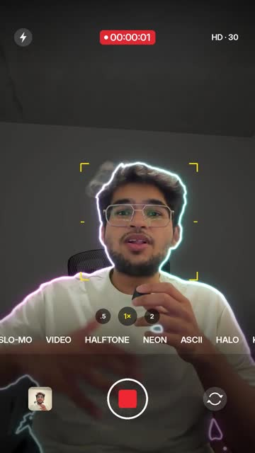</a><br><a href="https://drive.google.com/file/d/1Xhcc1PhLWrPN7zdfXWiWqe9c-VAGdc1v/view"><b>Camera modes</b></a><br><sub>Procedural VFX: lens flares, iris blink, film burn, light leaks · 16s</sub></td><td width="33%" valign="top"><a href="https://drive.google.com/file/d/1oZaovytBLsu2Iw0HlMSLcjxxfuzT7CEC/view"></a><br><a href="https://drive.google.com/file/d/1oZaovytBLsu2Iw0HlMSLcjxxfuzT7CEC/view"><b>The four yugs</b></a><br><sub>Speaker cut out and relit inside each world · 61s</sub></td></tr>
<tr><td width="33%" valign="top"><a href="https://drive.google.com/file/d/1w8xxV2TUKgTj7USJ6u6_llUsix5NXHHQ/view">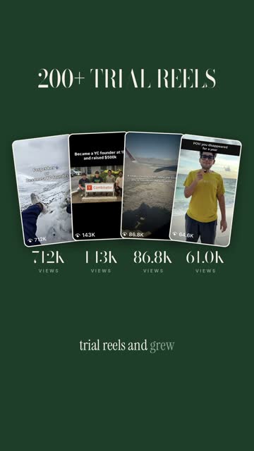</a><br><a href="https://drive.google.com/file/d/1w8xxV2TUKgTj7USJ6u6_llUsix5NXHHQ/view"><b>Claude edited my reels</b></a><br><sub>Forest and cream editorial with an energy pass · 49s</sub></td><td width="33%" valign="top"><a href="https://drive.google.com/file/d/1ricLWR8QiCwv7O5RlNqXa3Hl5GOa5Y0T/view"></a><br><a href="https://drive.google.com/file/d/1ricLWR8QiCwv7O5RlNqXa3Hl5GOa5Y0T/view"><b>My Instagram runs on Codex</b></a><br><sub>Reel covers orbit behind the head, AI composer UI · 54s</sub></td><td width="33%" valign="top"><a href="https://drive.google.com/file/d/1e1e_rinWJcd7Tr042GWJ4sen2H0CS_2Y/view">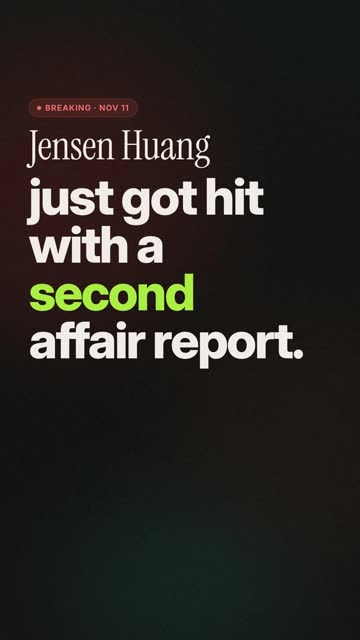</a><br><a href="https://drive.google.com/file/d/1e1e_rinWJcd7Tr042GWJ4sen2H0CS_2Y/view"><b>Who runs Nvidia?</b></a><br><sub>Motion-design news explainer with source chips · 58s</sub></td></tr>
<tr><td width="33%" valign="top"><a href="https://drive.google.com/file/d/1Dckf_Cfocw0Z4RRGmm-xQUkByEGqJDrY/view">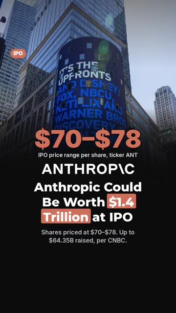</a><br><a href="https://drive.google.com/file/d/1Dckf_Cfocw0Z4RRGmm-xQUkByEGqJDrY/view"><b>Anthropic IPO</b></a><br><sub>News pager card with animated chart · 9s</sub></td><td width="33%" valign="top"><a href="https://drive.google.com/file/d/1tic3nGFCqlIeNNuIXVNAGQYn-r1GfMpd/view">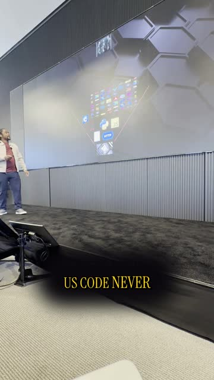</a><br><a href="https://drive.google.com/file/d/1tic3nGFCqlIeNNuIXVNAGQYn-r1GfMpd/view"><b>600K to 30K</b></a><br><sub>Keynote clip with a data card timed to the claim · 61s</sub></td><td width="33%" valign="top"><a href="https://drive.google.com/file/d/1WhZLPOUxT9prcmHBsv8vcIYUzrZY9gqV/view">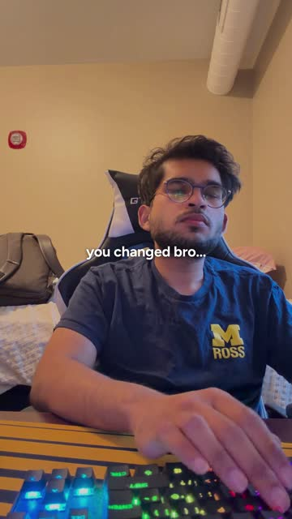</a><br><a href="https://drive.google.com/file/d/1WhZLPOUxT9prcmHBsv8vcIYUzrZY9gqV/view"><b>Directed by: Her</b></a><br><sub>Credits-roll hook · 15s</sub></td></tr>
<tr><td width="33%" valign="top"><a href="https://drive.google.com/file/d/1XXkZppmTL9TYWPFQuDjuvSywgDlNkkS8/view">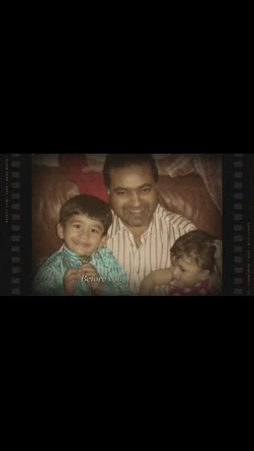</a><br><a href="https://drive.google.com/file/d/1XXkZppmTL9TYWPFQuDjuvSywgDlNkkS8/view"><b>My story</b></a><br><sub>HyperFrames life-story reel with voices · 62s</sub></td><td width="33%" valign="top"><a href="https://drive.google.com/file/d/1elhbxe2_KVLnlaXfRpItgjSnYgZQZln1/view">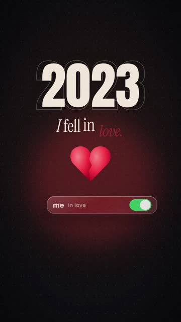</a><br><a href="https://drive.google.com/file/d/1elhbxe2_KVLnlaXfRpItgjSnYgZQZln1/view"><b>A fan&#x27;s journey</b></a><br><sub>HyperFrames story reel · 62s</sub></td><td width="33%" valign="top"><a href="https://drive.google.com/file/d/1xxML7UczYHTYvFmgy-N-lQGPWc393xiw/view">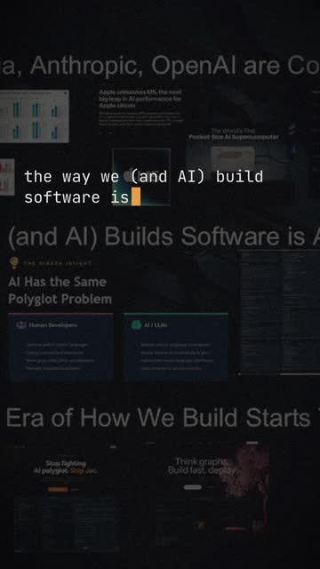</a><br><a href="https://drive.google.com/file/d/1xxML7UczYHTYvFmgy-N-lQGPWc393xiw/view"><b>Jac: the next era</b></a><br><sub>Cinematic event film · 73s</sub></td></tr>
<tr><td width="33%" valign="top"><a href="https://drive.google.com/file/d/1mpdya7Rg-HECcYrBiQTP0jmJcsS_W3Gc/view"></a><br><a href="https://drive.google.com/file/d/1mpdya7Rg-HECcYrBiQTP0jmJcsS_W3Gc/view"><b>My Claude is just better</b></a><br><sub>Reaction hook into a full product ad · 60s</sub></td><td width="33%" valign="top"><a href="https://drive.google.com/file/d/1o5LBnZik0jjULMAT6Rn91TxOHrl_7H4k/view"></a><br><a href="https://drive.google.com/file/d/1o5LBnZik0jjULMAT6Rn91TxOHrl_7H4k/view"><b>Claude-coded product ad</b></a><br><sub>Landscape motion-design ad · 57s</sub></td></tr>
</table>
<!-- reels:end -->

## The looks

76 looks, each one a short preview of a repeatable style: hooks, type treatments, overlays, card layouts, world-bending effects and motion design. Click a preview to play it. "runs here" means the builder is in this repo.

<!-- looks:start -->
<table>
<tr><td width="25%" valign="top"><a href="catalog/previews/tpl/motion-one-shape.mp4">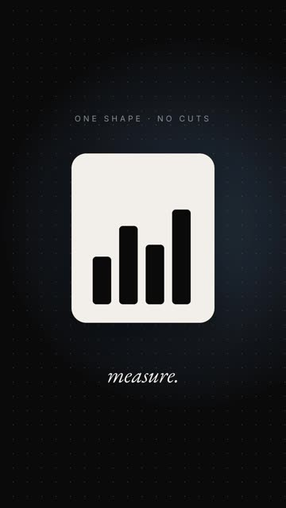</a><br><b>Motion design: one shape, no cuts</b><br><sub>template · runs here · bin/motion-reel.sh</sub></td><td width="25%" valign="top"><a href="catalog/previews/tpl/pager-news-card.mp4">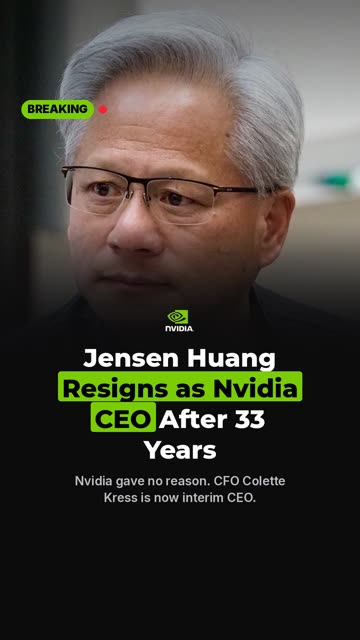</a><br><b>News pager card</b><br><sub>template · runs here · bin/pager-reel.py</sub></td><td width="25%" valign="top"><a href="catalog/previews/tpl/forest-cream-editorial.mp4"></a><br><b>Forest &amp; cream editorial</b><br><sub>template · preview · skill</sub></td><td width="25%" valign="top"><a href="catalog/previews/tpl/energy-walk-talk.mp4"></a><br><b>Energy pass (walk-and-talk)</b><br><sub>template · runs here · sfx-kit.py</sub></td></tr>
<tr><td width="25%" valign="top"><a href="catalog/previews/tpl/cover-orbit-claude-ui.mp4">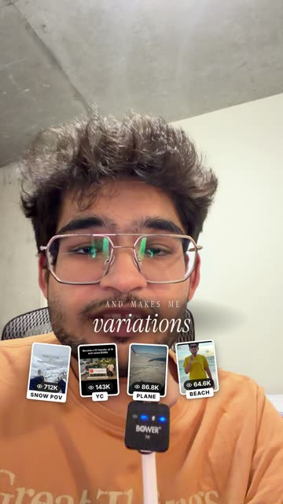</a><br><b>Cover orbit + Claude UI</b><br><sub>template · runs here · bin/face-track.py</sub></td><td width="25%" valign="top"><a href="catalog/previews/tpl/claude-chat-motion-ui.mp4"></a><br><b>Claude chat motion UI</b><br><sub>template · preview · HyperFrames</sub></td><td width="25%" valign="top"><a href="catalog/previews/tpl/druk-title.mp4"></a><br><b>Tall condensed title (Druk-style)</b><br><sub>template · runs here · bin/druk-inspired-title.py</sub></td><td width="25%" valign="top"><a href="catalog/previews/tpl/concept-explainer-overlay.mp4">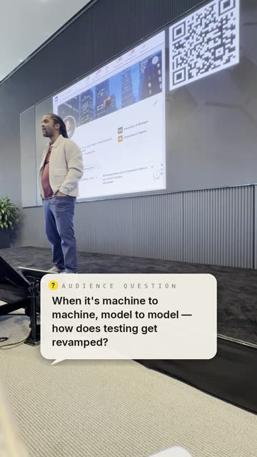</a><br><b>Concept explainer overlay</b><br><sub>template · runs here · make-captions.py</sub></td></tr>
<tr><td width="25%" valign="top"><a href="catalog/previews/tpl/typewriter-hook.mp4">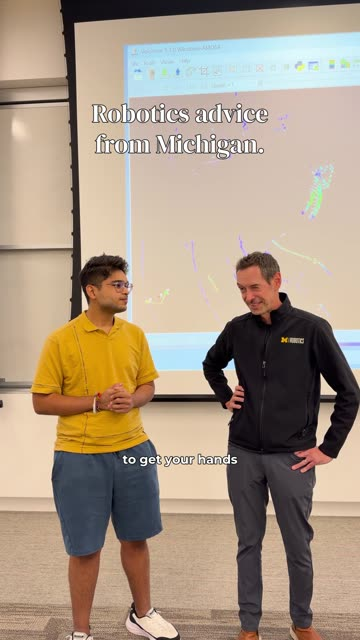</a><br><b>Typewriter opener</b><br><sub>template · runs here · typewriter.py</sub></td><td width="25%" valign="top"><a href="catalog/previews/tpl/promo-kinetic.mp4">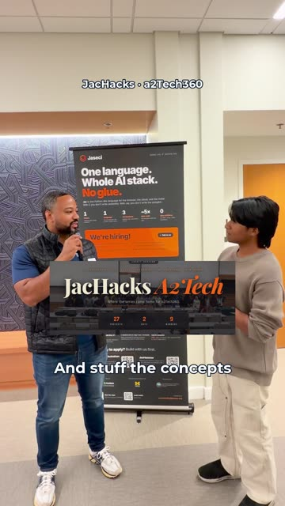</a><br><b>Mumbai promo (kinetic Anton)</b><br><sub>template · runs here · kinetic-hook.py</sub></td><td width="25%" valign="top"><a href="catalog/previews/tpl/yc-heartbreak-pack.mp4">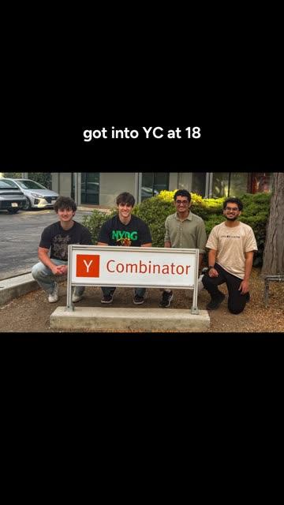</a><br><b>YC x heartbreak hooks</b><br><sub>template · preview · videos/yc-heartbreak-pack/gen.py</sub></td><td width="25%" valign="top"><a href="catalog/previews/tpl/yc-question-list.mp4">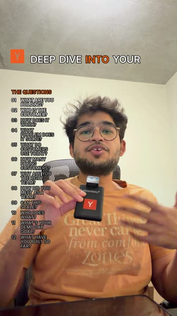</a><br><b>YC interview question list</b><br><sub>template · runs here · bin/yc-interview-list.py</sub></td></tr>
<tr><td width="25%" valign="top"><a href="catalog/previews/tpl/travel-story.mp4"></a><br><b>Travel story</b><br><sub>template · runs here · travel-story-reel.sh</sub></td><td width="25%" valign="top"><a href="catalog/previews/tpl/travel-quote-sticker.mp4">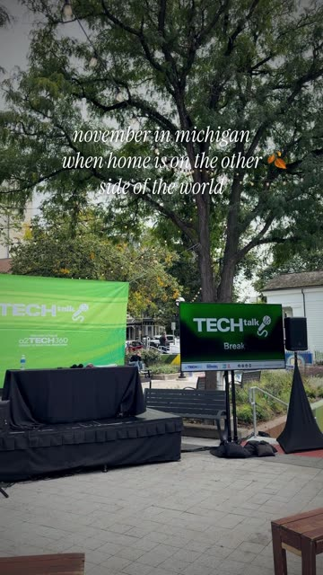</a><br><b>Travel quote sticker</b><br><sub>template · runs here · travel-quote-reel.py</sub></td><td width="25%" valign="top"><a href="catalog/previews/tpl/verified-evening.mp4"></a><br><b>Verified evening reel</b><br><sub>template · runs here · bin/evening-reel.py</sub></td><td width="25%" valign="top"><a href="catalog/previews/tpl/food-reel.mp4">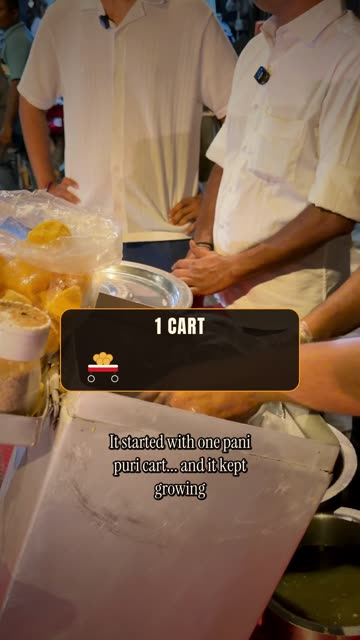</a><br><b>Food / street-food reel</b><br><sub>template · preview · videos/khau-galli/build.py</sub></td></tr>
<tr><td width="25%" valign="top"><a href="catalog/previews/tpl/diwali-street-times.mp4">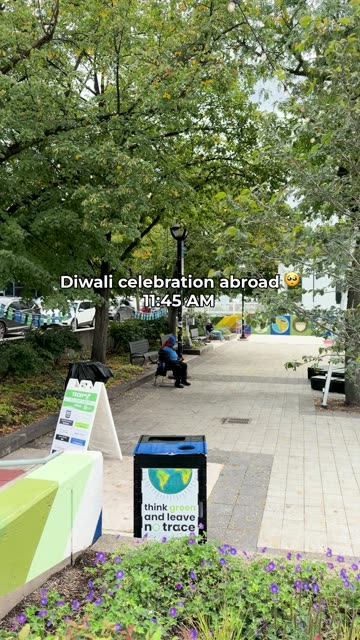</a><br><b>Diwali abroad (street times)</b><br><sub>template · preview · project</sub></td><td width="25%" valign="top"><a href="catalog/previews/tpl/gym-stat.mp4"></a><br><b>Gym stat typography</b><br><sub>template · runs here · bin/umich-gym-reel.sh</sub></td><td width="25%" valign="top"><a href="catalog/previews/tpl/liquid-glass.mp4">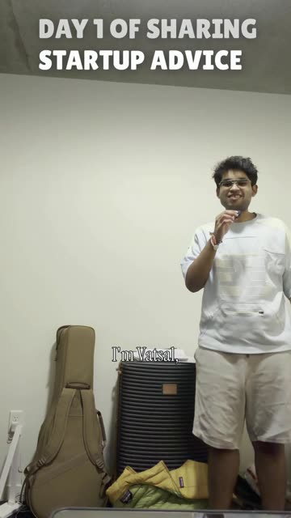</a><br><b>Liquid glass UI</b><br><sub>template · preview · skill</sub></td><td width="25%" valign="top"><a href="catalog/previews/fx/noise.mp4">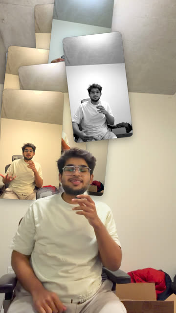</a><br><b>noise</b><br><sub>effect · runs here · bin/fx-extra.sh</sub></td></tr>
<tr><td width="25%" valign="top"><a href="catalog/previews/fx/lineup.mp4">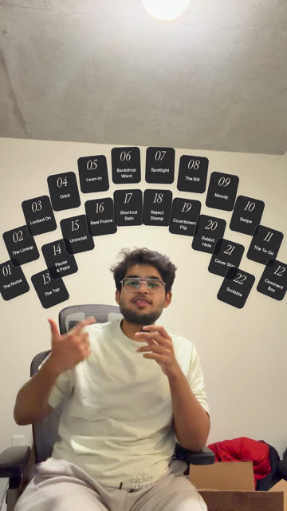</a><br><b>lineup</b><br><sub>effect · runs here · bin/fx-extra.sh</sub></td><td width="25%" valign="top"><a href="catalog/previews/fx/locked-on.mp4">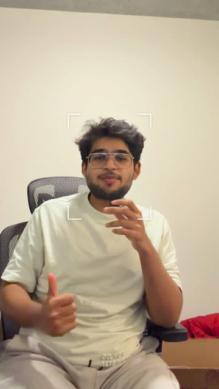</a><br><b>locked-on</b><br><sub>effect · runs here · bin/fx-extra.sh</sub></td><td width="25%" valign="top"><a href="catalog/previews/fx/orbit.mp4">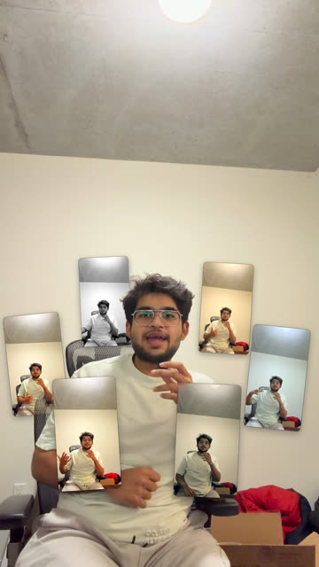</a><br><b>orbit</b><br><sub>effect · runs here · bin/fx-extra.sh</sub></td><td width="25%" valign="top"><a href="catalog/previews/fx/lean-in.mp4"></a><br><b>lean-in</b><br><sub>effect · runs here · bin/fx-extra.sh</sub></td></tr>
<tr><td width="25%" valign="top"><a href="catalog/previews/fx/backdrop-word.mp4">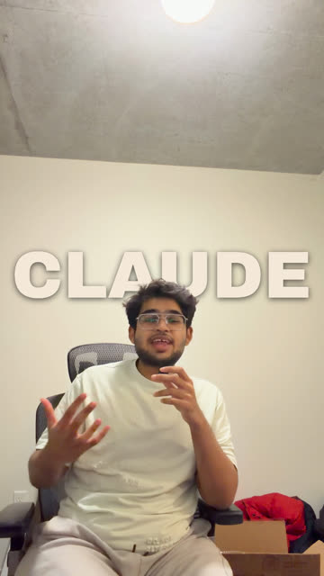</a><br><b>backdrop-word</b><br><sub>effect · runs here · bin/fx-extra.sh</sub></td><td width="25%" valign="top"><a href="catalog/previews/fx/spotlight.mp4"></a><br><b>spotlight</b><br><sub>effect · runs here · bin/fx-extra.sh</sub></td><td width="25%" valign="top"><a href="catalog/previews/fx/the-bill.mp4">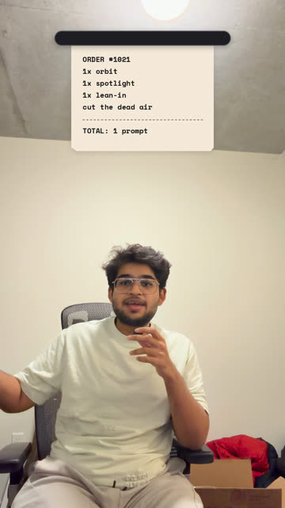</a><br><b>the-bill</b><br><sub>effect · runs here · bin/fx-extra.sh</sub></td><td width="25%" valign="top"><a href="catalog/previews/fx/moody.mp4"></a><br><b>moody</b><br><sub>effect · runs here · bin/fx-extra.sh</sub></td></tr>
<tr><td width="25%" valign="top"><a href="catalog/previews/fx/swipe.mp4">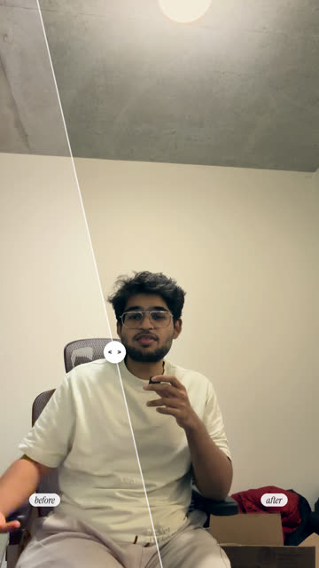</a><br><b>swipe</b><br><sub>effect · runs here · bin/fx-extra.sh</sub></td><td width="25%" valign="top"><a href="catalog/previews/fx/todo.mp4">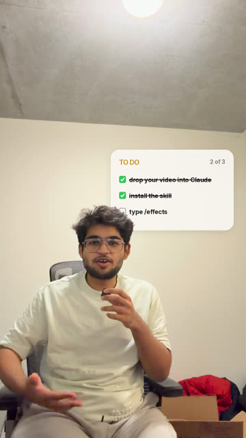</a><br><b>todo</b><br><sub>effect · runs here · bin/fx-extra.sh</sub></td><td width="25%" valign="top"><a href="catalog/previews/fx/tap.mp4"></a><br><b>tap</b><br><sub>effect · runs here · bin/fx-extra.sh</sub></td><td width="25%" valign="top"><a href="catalog/previews/fx/pause-point.mp4">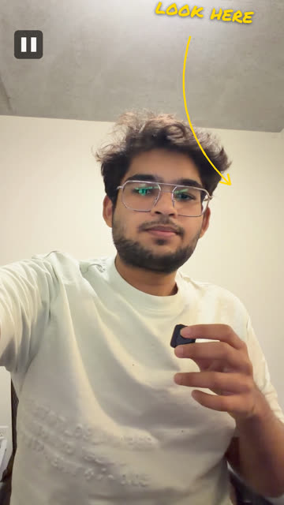</a><br><b>pause-point</b><br><sub>effect · runs here · bin/fx-extra.sh</sub></td></tr>
<tr><td width="25%" valign="top"><a href="catalog/previews/fx/uninstall.mp4">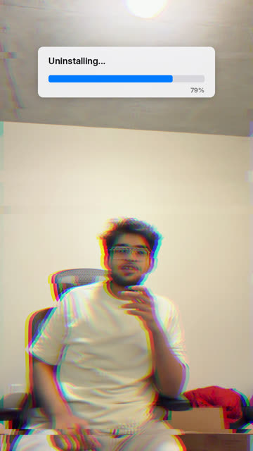</a><br><b>uninstall</b><br><sub>effect · runs here · bin/fx-extra.sh</sub></td><td width="25%" valign="top"><a href="catalog/previews/fx/reel-frame.mp4"></a><br><b>reel-frame</b><br><sub>effect · runs here · bin/fx-extra.sh</sub></td><td width="25%" valign="top"><a href="catalog/previews/fx/shortcut-rain.mp4">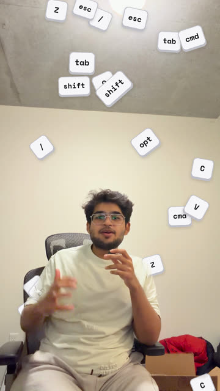</a><br><b>shortcut-rain</b><br><sub>effect · runs here · bin/fx-extra.sh</sub></td><td width="25%" valign="top"><a href="catalog/previews/fx/reject-stamp.mp4">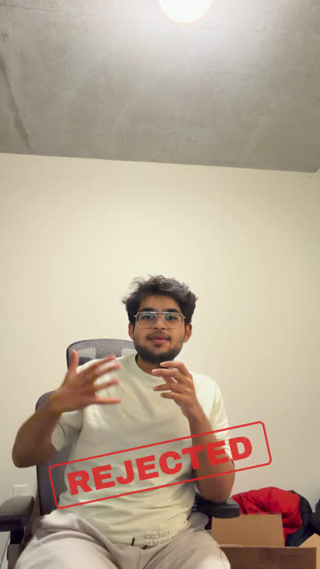</a><br><b>reject-stamp</b><br><sub>effect · runs here · bin/fx-extra.sh</sub></td></tr>
<tr><td width="25%" valign="top"><a href="catalog/previews/fx/countdown-flip.mp4">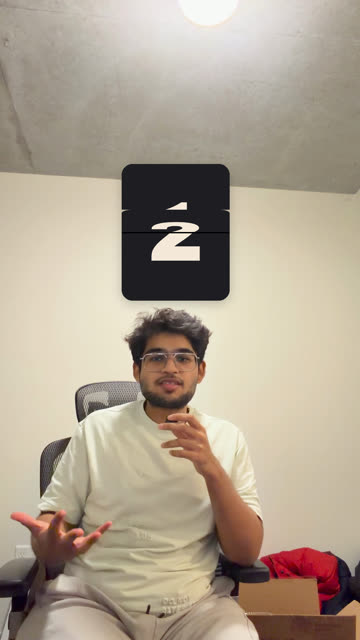</a><br><b>countdown-flip</b><br><sub>effect · runs here · bin/fx-extra.sh</sub></td><td width="25%" valign="top"><a href="catalog/previews/fx/rabbit-hole.mp4">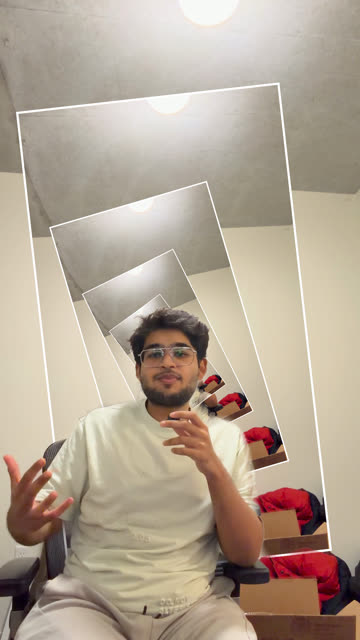</a><br><b>rabbit-hole</b><br><sub>effect · runs here · bin/fx-extra.sh</sub></td><td width="25%" valign="top"><a href="catalog/previews/fx/cover-star.mp4">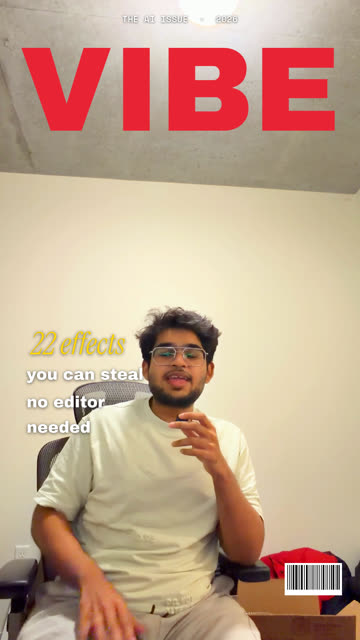</a><br><b>cover-star</b><br><sub>effect · runs here · bin/fx-extra.sh</sub></td><td width="25%" valign="top"><a href="catalog/previews/fx/scribble.mp4">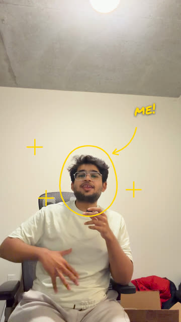</a><br><b>scribble</b><br><sub>effect · runs here · bin/fx-extra.sh</sub></td></tr>
<tr><td width="25%" valign="top"><a href="catalog/previews/fx/red-collage.mp4">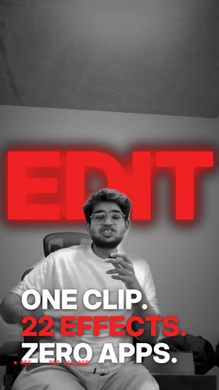</a><br><b>red-collage</b><br><sub>effect · runs here · bin/fx-extra.sh</sub></td><td width="25%" valign="top"><a href="catalog/previews/fx/split-headline.mp4">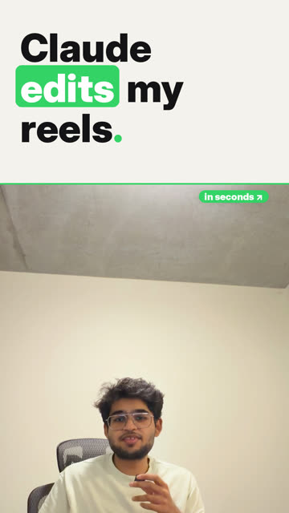</a><br><b>split-headline</b><br><sub>effect · runs here · bin/fx-extra.sh</sub></td><td width="25%" valign="top"><a href="catalog/previews/fx/pastel-word.mp4">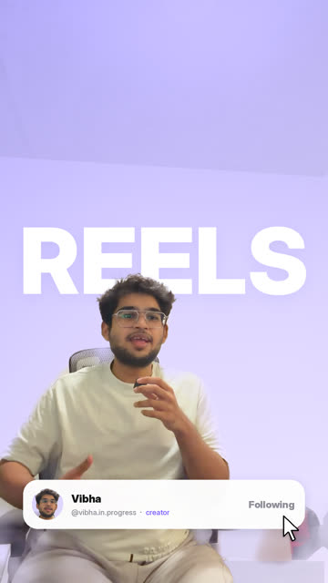</a><br><b>pastel-word</b><br><sub>effect · runs here · bin/fx-extra.sh</sub></td><td width="25%" valign="top"><a href="catalog/previews/fx/check-pills.mp4">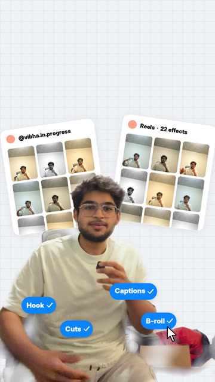</a><br><b>check-pills</b><br><sub>effect · runs here · bin/fx-extra.sh</sub></td></tr>
<tr><td width="25%" valign="top"><a href="catalog/previews/fx/headline-box.mp4">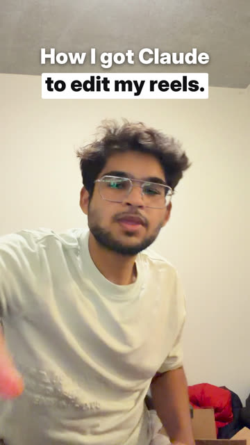</a><br><b>headline-box</b><br><sub>effect · runs here · bin/fx-extra.sh</sub></td><td width="25%" valign="top"><a href="catalog/previews/fx/profile-wall.mp4">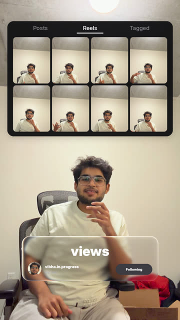</a><br><b>profile-wall</b><br><sub>effect · runs here · bin/fx-extra.sh</sub></td><td width="25%" valign="top"><a href="catalog/previews/fx/tier-list.mp4">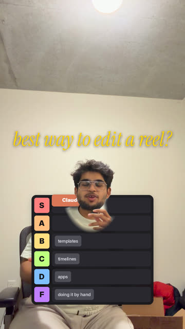</a><br><b>tier-list</b><br><sub>effect · runs here · bin/fx-extra.sh</sub></td><td width="25%" valign="top"><a href="catalog/previews/fx/broll-split.mp4">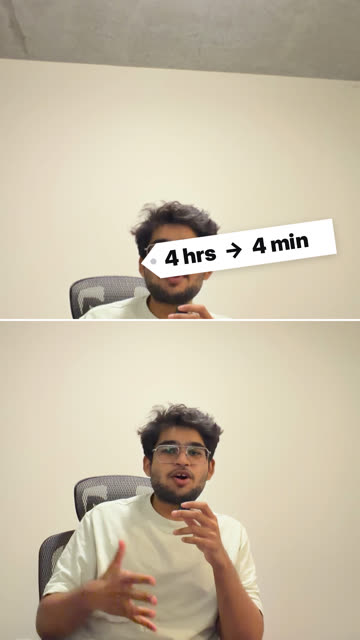</a><br><b>broll-split</b><br><sub>effect · runs here · bin/fx-extra.sh</sub></td></tr>
<tr><td width="25%" valign="top"><a href="catalog/previews/fx/phone-fan.mp4">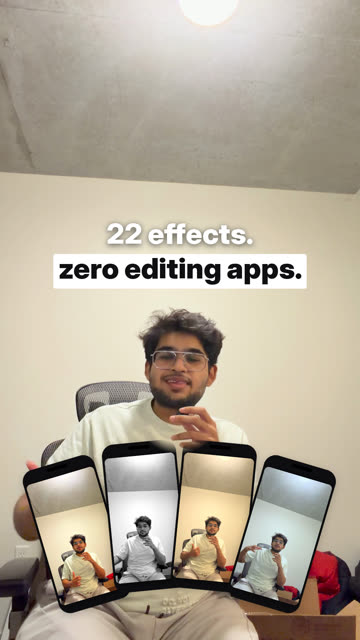</a><br><b>phone-fan</b><br><sub>effect · runs here · bin/fx-extra.sh</sub></td><td width="25%" valign="top"><a href="catalog/previews/fx/dot-reveal.mp4">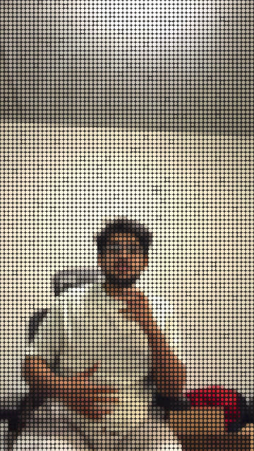</a><br><b>dot-reveal</b><br><sub>effect · runs here · bin/fx-extra.sh</sub></td><td width="25%" valign="top"><a href="catalog/previews/fx/headline-wall.mp4">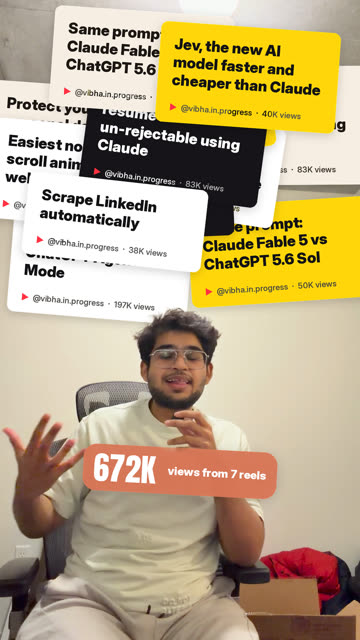</a><br><b>headline-wall</b><br><sub>effect · runs here · bin/fx-extra.sh</sub></td><td width="25%" valign="top"><a href="catalog/previews/fx/checklist.mp4"></a><br><b>checklist</b><br><sub>effect · runs here · bin/fx-extra.sh</sub></td></tr>
<tr><td width="25%" valign="top"><a href="catalog/previews/fx/glass-widgets.mp4"></a><br><b>glass-widgets</b><br><sub>effect · runs here · bin/fx-extra.sh</sub></td><td width="25%" valign="top"><a href="catalog/previews/fx/timeline.mp4"></a><br><b>timeline</b><br><sub>effect · runs here · bin/fx-extra.sh</sub></td><td width="25%" valign="top"><a href="catalog/previews/fx/comment-box.mp4"></a><br><b>comment-box</b><br><sub>effect · runs here · bin/fx-extra.sh</sub></td><td width="25%" valign="top"><a href="catalog/previews/fx/liquid-glass-graph.mp4"></a><br><b>liquid-glass-graph</b><br><sub>effect · runs here · bin/fx-extra.sh</sub></td></tr>
<tr><td width="25%" valign="top"><a href="catalog/previews/fx/carousel-spin.mp4"></a><br><b>carousel-spin</b><br><sub>effect · runs here · bin/fx-extra.sh</sub></td><td width="25%" valign="top"><a href="catalog/previews/fx/match-cut.mp4"></a><br><b>match-cut</b><br><sub>effect · runs here · bin/fx-extra.sh</sub></td><td width="25%" valign="top"><a href="catalog/previews/fx/apple-toggles.mp4"></a><br><b>apple-toggles</b><br><sub>effect · runs here · bin/fx-extra.sh</sub></td><td width="25%" valign="top"><a href="catalog/previews/fx/led-sign.mp4"></a><br><b>led-sign</b><br><sub>effect · runs here · bin/fx-extra.sh</sub></td></tr>
<tr><td width="25%" valign="top"><a href="catalog/previews/fx/slow-push.mp4"></a><br><b>slow-push</b><br><sub>effect · runs here · bin/fx-extra.sh</sub></td><td width="25%" valign="top"><a href="catalog/previews/fx/over-the-shoulder-zoom.mp4"></a><br><b>over-the-shoulder-zoom</b><br><sub>effect · runs here · bin/fx-extra.sh</sub></td><td width="25%" valign="top"><a href="catalog/previews/fx/messages.mp4"></a><br><b>messages</b><br><sub>effect · runs here · bin/fx-extra.sh</sub></td><td width="25%" valign="top"><a href="catalog/previews/fx/place-in-grid.mp4"></a><br><b>place-in-grid</b><br><sub>effect · runs here · bin/fx-extra.sh</sub></td></tr>
<tr><td width="25%" valign="top"><a href="catalog/previews/fx/tape-label.mp4"></a><br><b>tape-label</b><br><sub>effect · runs here · bin/fx-extra.sh</sub></td><td width="25%" valign="top"><a href="catalog/previews/fx/select-resize.mp4"></a><br><b>select-resize</b><br><sub>effect · runs here · bin/fx-extra.sh</sub></td><td width="25%" valign="top"><a href="catalog/previews/fx/wave-trim.mp4"></a><br><b>wave-trim</b><br><sub>effect · runs here · bin/fx-extra.sh</sub></td><td width="25%" valign="top"><a href="catalog/previews/fx/huge-strike.mp4"></a><br><b>huge-strike</b><br><sub>effect · runs here · bin/fx-extra.sh</sub></td></tr>
<tr><td width="25%" valign="top"><a href="catalog/previews/fx/crayon-write.mp4"></a><br><b>crayon-write</b><br><sub>effect · runs here · bin/fx-extra.sh</sub></td><td width="25%" valign="top"><a href="catalog/previews/fx/fan-build.mp4"></a><br><b>fan-build</b><br><sub>effect · runs here · bin/fx-extra.sh</sub></td><td width="25%" valign="top"><a href="catalog/previews/fx/spotify-scroll.mp4"></a><br><b>spotify-scroll</b><br><sub>effect · runs here · bin/fx-extra.sh</sub></td><td width="25%" valign="top"><a href="catalog/previews/fx/tech-widgets.mp4"></a><br><b>tech-widgets</b><br><sub>effect · runs here · bin/fx-extra.sh</sub></td></tr>
<tr><td width="25%" valign="top"><a href="catalog/previews/fx/glass-tunnel.mp4"></a><br><b>glass-tunnel</b><br><sub>effect · runs here · bin/fx-extra.sh</sub></td><td width="25%" valign="top"><a href="catalog/previews/fx/notes-app.mp4"></a><br><b>notes-app</b><br><sub>effect · runs here · bin/fx-extra.sh</sub></td><td width="25%" valign="top"><a href="catalog/previews/fx/story-portal.mp4"></a><br><b>story-portal</b><br><sub>effect · runs here · bin/fx-extra.sh</sub></td><td width="25%" valign="top"><a href="catalog/previews/fx/yap-headline.mp4"></a><br><b>yap-headline</b><br><sub>effect · runs here · bin/fx-extra.sh</sub></td></tr>
</table>
<!-- looks:end -->

## Start a video: which kind is it?

The agent asks this first, because each kind is built differently. The full intake, with the follow-up questions and tools for each, is in [`START-HERE.md`](START-HERE.md).

| Kind | What makes it feel right | Start with |
|---|---|---|
| Talking-head edit | speech flows, captions sit in the safe box, effects land on words | `bin/build-story-reel.sh`, `bin/fx-extra.sh` |
| Motion design | one element carries the eye, no cuts, everything eases, it loops | `bin/motion-reel.sh motion/one-shape out.mp4` |
| Hybrid | motion inserts timed to the word they explain | a HyperFrames comp per insert + `bin/composite-layers.py` |
| Footage montage | the payoff cut lands on the drop | `bin/music-map.py`, `bin/beat-reel.sh` |
| Faceless clip | every claim sourced, the speaker credited | `bin/podcast-clip.sh`, `bin/pager-reel.py` |

Not sure which look? `bin/reel-pick suggest "your brief"` ranks them, and `bin/reel-pick` opens the visual picker at http://localhost:8771.

## Try it in two minutes

```bash
git clone https://github.com/Vatsal2006350/video-edits && cd video-edits
bin/fx-extra.sh list                                    # sets up the effect venv once, lists 70 effects
bin/fx-extra.sh halo-rays my-clip.mp4 out/halo.mp4 --start 1 --end 4
bin/motion-reel.sh motion/one-shape out/one-shape.mp4  # renders the motion-design starter
python3 bin/ig-safe.py view out/halo.mp4 out/halo-safe.jpg  # safe-box contact sheet
bash bin/export-ig.sh out/halo.mp4 out/halo_IG.mp4     # upload copy: 44.1 kHz stereo, loudness normalised
```

You need ffmpeg, Python 3 and Node 18+. Footage, music and fonts are yours to supply ([`fonts/README.md`](fonts/README.md) lists the faces).

## How a reel gets made

1. **Pick the kind and the look.** [`START-HERE.md`](START-HERE.md), then the note in [`formats/`](formats/).
2. **Write a spec.** A short JSON or manifest: cut points, words, colours, music beat.
3. **Render the layers.** Type, cards and effects render as separate layers ([`bin/typewriter.py`](bin/typewriter.py), [`bin/kinetic-hook.py`](bin/kinetic-hook.py), [`bin/hero-type.py`](bin/hero-type.py), the effect library), or a HyperFrames comp for motion design.
4. **Composite.** [`bin/composite-layers.py`](bin/composite-layers.py) stacks PNG sequences and mattes frame by frame, so no frame is dropped.
5. **Check.** [`bin/ig-safe.py`](bin/ig-safe.py) for the safe box, [`bin/motion-qc.py`](bin/motion-qc.py) for fast sections, [`bin/reel-qc.py`](bin/reel-qc.py) for the rest.
6. **Export.** [`bin/export-ig.sh`](bin/export-ig.sh) writes the Instagram copy: stereo 44.1 kHz AAC, loudness normalised, constant 30 fps, Rec.709 tagged.

## Explore the code

| Where | What you will find |
|---|---|
| [`START-HERE.md`](START-HERE.md) | The intake: which kind of video, what to ask, which tools. |
| [`bin/`](bin/) | Builders, renderers, the reel picker, QA and export tools. Each script's header says what it does. |
| [`effects/`](effects/) | The effect engines: our 70-effect library and the vendored MIT packs it builds on. |
| [`motion/`](motion/) | Motion-design compositions (HTML, rendered by HyperFrames). |
| [`formats/`](formats/) | One note per proven look, with the numbers it was measured at. Read these before the code. |
| [`catalog/`](catalog/) | The look catalog and preview clips the picker and gallery read. |
| [`gallery/`](gallery/) | `looks.json` and `reels.json`; `bin/build-readme.py` writes the tables above from them. |
| [`research/`](research/) | Dated, cited notes on trends and production choices. |
| [`docs/INVENTORY.md`](docs/INVENTORY.md) | The older full tool inventory, with setup notes. |

## Rules every reel here follows

- **Frame:** 1080×1920 at 30 fps. Instagram's safe box is x 59–918, y 278–1536; centred text is bounded by 724 px.
- **Colour:** iPhone HLG footage is tonemapped to Rec.709 before any grade, otherwise the picture goes flat.
- **Sound:** the music bed is ducked under the voice, so the speech stays clear.
- **Facts only:** a caption or number that cannot be checked against the footage, the speaker's words or a cited source is not written.
- **Motion:** transforms, not layout; one easing family; no dead frames ([`formats/motion-design.md`](formats/motion-design.md)).

## Credits and takedowns

The effect library builds on two MIT-licensed packs: Vibha Ramprakash's claude-video-effects and Charlie Hills' reel-editing-skills. Their licences are in [`effects/LICENSES/`](effects/LICENSES/). The motion-design brief takes its cue from the public collection of Claude Opus 5.5 videos (yihui-dev/awesome-opus5-5-videos).

Third-party names, logos, photos and music belong to their owners. If you appear in a reel or preview and want it removed, open an issue and it will come out.

## Licence

MIT. See [`LICENSE`](LICENSE).
